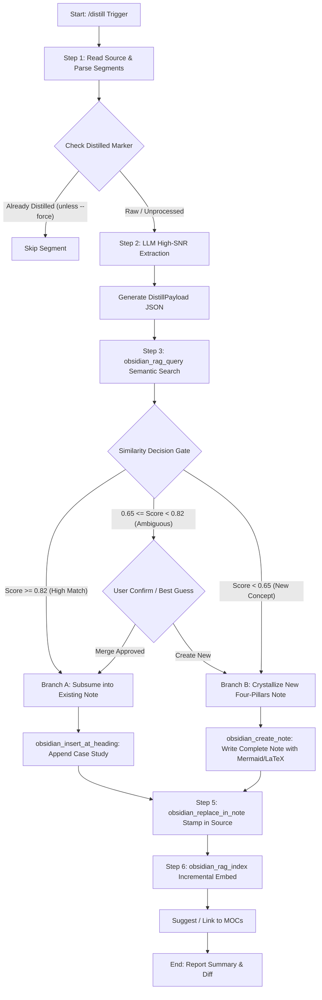

# gemini-obsidian 知识脱水流水线架构规格说明书 (SPEC-DISTILL)

## 1. 背景与设计动机 (Motivation & Ecosystem Gap)

### 1.1 现状与痛点剖析：原油采集膨胀 vs 提炼摩擦
在个人知识管理（PKM）与智能体长期记忆工程（Agent Long-Term Memory）的长期实践中，用户与 AI 协同工作会产生大量伴随心流的高频碎片输入：
- **时序日志的线性膨胀（Journal Inflation）**：日常工作通过 `journal` 技能记录了高密度的排错步骤、临时想法、CAN/SOMEIP 信号逆向分析、嵌入式 QML/C++ 崩溃堆栈以及考研高数推导草稿。这类内容沉淀在 `50-Journal/`（或 `Daily Notes/`）中，具有强烈的**时间依赖性与上下文噪音**。
- **认知提炼的高摩擦力（Distillation Friction）**：传统笔记重构往往依赖用户定期手动“翻阅日记 ➔ 剪切提炼 ➔ 决定放到哪个目录 ➔ 找寻关联旧笔记 ➔ 补齐元数据”。由于认知负荷过大，绝大多数日常日志在写下的那一刻便成为了“只写不读”的数字墓地。
- **直接 RAG 检索的低信噪比陷阱（Raw RAG Noise）**：若不对日记进行提炼，直接通过向量库（Embedding / RAG）进行全局检索，时序日记中的临时猜想、中间排错失败日志以及过时的上下文会严重污染语义空间，导致后续 AI 智能体产生幻觉或检索出错误的过时结论。

### 1.2 现有生态位缺口 (Ecosystem Gap)
当前 `gemini-obsidian` 扩展生态已具备丰富的离散操作与后置整理工具，但在“从碎片原油到机制晶体”的自动化处理管道上存在明显断层：
- `journal` / `obsidian_append_daily_log`：只管采集原油（Append-only），缺乏自省与凝练；
- `compound`：侧重于跨多个项目（`working/*/knowledge/*.md`）发现重复概念并提升至全局 `Engineering/`，粒度较粗，无法处理单日日志内的战役级经验；
- `cross-linker`：仅针对现有 Markdown 词汇做被动双向链接织网，无法完成“从经验描述到四大支柱机制架构”的语义升维；
- `vault-lint`：专注于坏链、孤儿文件与元数据合规性检查，属于质量守门人，不负责内容提炼。

**缺失的关键环节**正是：**`distill`（知识脱水流水线）**——一个将非结构化、充满噪音的日常草稿/日志（原油），全自动解析、脱水、语义查重、智能归宿决断并非破坏性回链的自动化加工厂。

### 1.3 `gemini-obsidian` 全生命周期生态位定位
通过引入 `/distill`，`gemini-obsidian` 形成了严格闭环的知识生命周期流水线：

```
                    ┌──────────────────────────────────────────────┐
                    │               50-Journal / Inbox             │
                    │        (日记原油：高噪音、强时序、高流动性)       │
                    └──────────────────────┬───────────────────────┘
                                           │
                                           │  【/distill】知识脱水流水线
                                           ▼
                    ┌──────────────────────────────────────────────┐
                    │       高信号原子机制卡片 / 经典案例挂载         │
                    │     (30-Engineering / 40-Mathematics)        │
                    └──────────────┬───────────────────────────────┘
                                   │
         ┌─────────────────────────┼─────────────────────────┐
         ▼                         ▼                         ▼
┌─────────────────┐       ┌─────────────────┐       ┌─────────────────┐
│   /compound     │       │  /cross-linker  │       │   /vault-lint   │
│ (跨项目模式升维) │       │ (全库语义立交桥) │       │ (健康巡检与坏链) │
└─────────────────┘       └─────────────────┘       └─────────────────┘
```

---

## 2. 核心架构原则 (Guiding Architectural Principles)

### 2.1 Zero-dependency (纯 MCP 原生工具编排)
- **零外部服务进程**：绝不引入额外的 Python 运行时、独立数据库服务或后端守护进程。
- **纯粹的工具编排（Tool Composition）**：整个脱水引擎基于 `gemini-obsidian` 已经内置并导出的 MCP Tools 原生 API 构建，直接复用现有的 Node.js + Transformers.js 本地向量检索（`obsidian_rag_query`、`obsidian_rag_index`）及原子文件读写接口（`obsidian_read_note`、`obsidian_create_note`、`obsidian_insert_at_heading`、`obsidian_replace_in_note`）。
- **完全跨平台**：保持与现有插件一致的 Linux/macOS/Windows 开箱即用体验。

### 2.2 Subsumption over Fragmentation (机制为主、案例挂载)
- **严禁碎片化孤儿卡片**：严禁每解决一个 Bug 或完成一次调试就新建一个形如 `Bug-Fix-2026-10-12.md` 的零散卡片。碎片卡片不仅割裂认知，还会迅速耗尽本地向量索引空间。
- **增量吸纳（Subsumption）**：脱水提炼必须首先通过 RAG 查询该技术点的主干机制卡片（例如 `30-Engineering/QML-Signal-Slot-Deadlock.md`）。若存在，则将本次排错经验提炼为一个紧凑的**高信号案例片段（Case Study）**，增量挂载到该机制卡片的 `## 典型故障案例与现场演绎` 章节下。
- **机制立足（Mechanism First）**：只有在全局知识库中完全不存在对应机制底座时，才允许初始化新建一张全新的高密度机制卡片。

### 2.3 Four Pillars Blueprint (四大支柱卡片标准)
无论新建机制卡片还是向已有卡片追加案例，提炼出的知识必须严格遵循四大支柱蓝图标准，拒绝泛泛而谈的废话：
1. **支柱一：物理入口与真实路径 (Physical Entry Points)**：
   - 明确具体的物理源码路径、文件行号或符号定义（如 `src/vehicle/adas/AdasController.cpp:L142`、`qrc:/qml/DashboardView.qml`）。
2. **支柱二：假象 vs 真相 (Symptom vs. Ground Truth)**：
   - 清晰对比表面报错现象（Symptom）与深层物理根因（Ground Truth），剔除调试过程中的无效试错路径。
3. **支柱三：隐式契约与数据流拓扑 (Implicit Invariants & Mermaid Topology)**：
   - 暴露源码中未直接显式书写的并发时序、内存所有权转移规则、状态机迁移条件，并必须配齐原生 **Mermaid 序列图/流程图** 或 **无跳步 LaTeX 推导**（数理领域）。
4. **支柱四：避坑军规与防御性编码 (Preventative Action & Anti-Regression)**：
   - 提炼出针对未来工程的不可践踏军规（如“严禁在 QML 根对象加载完成前发射带参 C++ 信号”、“必须显式断开跨线程连接”）。

### 2.4 Non-destructive Provenance (非破坏性溯源与物理保真)
- **尊重原始日记真实性**：脱水流水线**绝不直接删除**原日记或草稿中的原始文本，确保开发者心流记录的完整性与历史回溯价值。
- **原处打标（In-place Stamping）**：在原日记对应段落的末尾安全注入 HTML 隐形/显式注释标记（如 `<!-- distilled: [[Engineering/QML-Architecture#Case-20261012]] @ 2026-10-12 10:30 -->`）。
- **双向锚点回链（Bi-directional Anchor Linking）**：
  - 原日记段落指向提炼后的机制卡片锚点；
  - 提炼后的机制卡片在来源说明中以 `[[50-Journal/2026-10-12#^distill-xxxx]]` 反向回链原日记，实现完整的认知证据链（Provenance Traceability）。

---

## 3. 命令与技能交互规范 (CLI / Skill Interface)

### 3.1 核心命令入口与语法

| 命令语法 | 执行模式 | 适用场景 |
| :--- | :--- | :--- |
| `/distill` | 默认交互模式 | 自动定位今日 Daily Note，扫描所有未脱水段落，依次交互引导确认 |
| `/distill <keyword>` | 关键词过滤模式 | 检索近期（默认 7 天）日记或 Inbox 中包含特定关键词的内容进行靶向脱水 |
| `/distill <file_path>` | 指定文件模式 | 对指定的草稿文件（如 `10-Inbox/draft-v2.md`）进行脱水提炼 |

### 3.2 可选 CLI 参数与标志位 (Flags)

- `--dry-run`：
  - **只读模拟模式**。输出完整的提炼 JSON Payload、查重命中的目标文件匹配度分析、以及计划修改的 Diff 预览，但**绝不修改任何物理文件**。
- `--new`：
  - **强制新建模式**。跳过与现有卡片的合并决断，强制在目标目录创建全新的机制卡片（常用于确信诞生了全新原子理论或独立技术领域的场景）。
- `--target <path>`：
  - **显式指定归宿**。跳过 RAG 自动推断，强制将脱水内容增量缝合到 `<path>` 指定的卡片中。
- `--force`：
  - **忽略已脱水标记**。对已经包含 `<!-- distilled: ... -->` 的段落重新执行提炼覆盖。
- `--section <heading>`：
  - **指定段落提取**。仅针对原文件中特定二级或三级标题（如 `## Work Log` 或 `### ADAS Bug Analysis`）下的内容执行脱水。

### 3.3 技能配置契约 (`skills/distill/SKILL.md`)

```yaml
---
name: distill
description: >-
  Extracts high-signal engineering and mathematical knowledge from daily notes or draft files,
  performs semantic deduplication against existing vault notes, and subsumes findings into core
  mechanism notes (or crystallizes new Four Pillars notes) with non-destructive in-place backlinking.
  Triggers on "/distill", "distill note", "extract knowledge", "crystallize note", "脱水", "知识提炼".
  Do NOT trigger for: simple note searching, daily log appending, or lint-only checks.
---
```

### 3.4 交互反馈体验标准 (UX & TTY Output)
针对交互式终端与非交互式 CI 运行环境，输出遵循以下格式化结构：
1. **[Scan Phase]**：清晰报告读取的文件路径、检测到的未打标段落总数与候选字数。
2. **[Distill Phase]**：以折叠/引用块展示 AI 提炼出的高信号 Payload 摘要（包括识别出的领域、技术模块、假象与真相）。
3. **[RAG Decision Phase]**：列出 `obsidian_rag_query` 检索到的前 3 个最相似卡片及其余弦匹配分（如 `[Match: 88.4%] 30-Engineering/QML-Rendering-Pipeline.md`）。
4. **[Action Confirmation]**：向用户明确呈现执行决策：
   - `[Action] Subsuming into: 30-Engineering/QML-Rendering-Pipeline.md ## 典型故障案例`
   - 或者 `[Action] Creating new note: 30-Engineering/CAN-Signal-Debounce-Mechanism.md`
5. **[Final Verification]**：打印原稿打标回链与向量索引增量重构完成的耗时与状态状态码。

---

## 4. DAG 状态机与执行流水线 (Detailed Execution DAG)

下图展示了知识脱水流水线完整的有向无环图（DAG）状态流转机制：



### 详细步骤分解与状态机行为定义：

#### Step 1: 原油解析与去重标记检查 (Raw Ingestion & Deduplication Check)
1. **源文件解析**：
   - 若无参数：调用 `obsidian_get_daily_note` 获取今日日记；
   - 若传参 `<file_path>`：调用 `obsidian_read_note({ file_path })`。
2. **段落级切片（Semantic Chunking）**：
   - 按照 Markdown 二级标题（`## `）、三级标题（`### `）或以三个反引号包裹的独立日志块进行逻辑分段；
3. **标记扫描过滤**：
   - 对每一个段落进行正则检测：
     ```regex
     <!--\s*distilled:\s*\[\[([^\]]+)\]\]\s*@?\s*([^\-]*)\s*-->
     ```
   - 若匹配成功且未指定 `--force`，判定为已处理，直接略过；
   - 汇总所有未打标段落作为脱水候选集。

#### Step 2: LLM 高信号脱水提炼 (Signal Extraction & Synthesis Engine)
对候选文本段落执行零废话的高信号提炼，调用系统 LLM，输入严格的 Prompt 规约，生成标准 `DistillPayload` 数据结构：
- **过滤噪声**：滤除“今天上午开会”、“感觉有点卡”、“喝了杯咖啡”等环境杂讯；
- **提取硬核知识**：
  - 核心概念/机制名称（Concept Name）；
  - 目标分类体系（`30-Engineering` 或 `40-Mathematics`）；
  - 物理入口（Physical Entry: 文件路径、类名、行号）；
  - 假象 vs 物理真相；
  - 隐式契约与核心机制时序（转换为 Mermaid 图）；
  - 防御性军规代码片段或 LaTeX 推导。

#### Step 3: RAG 语义查重与归宿判定 (Semantic Search & Decision Boundary)
1. 提取提炼出的 `concept_name` 与 `summary`，构造 RAG 检索 Query；
2. 调用 `obsidian_rag_query({ query: query_str, limit: 5 })`；
3. 获取 top-5 结果的 chunk 列表、归属文件路径及相关性得分；
4. **决策门禁阈值（Decision Matrix）**：
   - **强相关（Score >= 0.82）**：极大概率是已有机制的延伸或重现，直接选中该主干文件作为挂载目标；
   - **弱相关（0.65 <= Score < 0.82）**：相似但有偏差。在交互模式下列出候选并询问用户，非交互模式下根据文件名语义相关度判断或优先降级为新建机制卡片；
   - **全新概念（Score < 0.65）**：确认为库内新概念，自动流转至 Branch B。

#### Step 4: 双轨决断与文档渲染 (Dual-Track Resolution)

##### 分支 A：增量吸纳缝合案例 (Branch Subsume)
1. 读取目标卡片，检查是否存在 `## 典型故障案例与现场演绎` 或 `## 案例与验证` 章节；
2. 若不存在，调用 `obsidian_insert_at_heading` 创建该二级标题；
3. 构造案例 Markdown 块：
   ```markdown
   ### 案例：[YYYY-MM-DD] {{case_title}} ^case-{{timestamp}}
   - **来源日记**：[[{{source_journal_path}}#^raw-{{timestamp}}|原始心流日志]]
   - **故障现场/问题背景**：{{symptom}}
   - **深层因果链条**：{{root_cause}}
   - **根治措施与验证**：{{resolution}}
   - **验证代码/指令**：
   ```{{language}}
   {{snippet}}
   ```
   ```
4. 调用 `obsidian_insert_at_heading({ file_path: target_path, heading: "典型故障案例与现场演绎", content: case_block, position: "end" })`。

##### 分支 B：结晶新建四大支柱机制卡片 (Branch Crystallize)
1. 根据模块命名规则，推导规范的笔记文件名（例如 `30-Engineering/CAN-Bus-Frame-Debounce-Mechanism.md`）；
2. 构造具备四大支柱的标准 Markdown 全文（含 YAML Frontmatter、Mermaid 图表、隐式契约矩阵）；
3. 调用 `obsidian_create_note({ file_path: new_note_path, content: full_note_content })`。

#### Step 5: 原处溯源打标与双向链接回填 (In-place Provenance Stamp)
1. 为原日记段落计算唯一锚点标记（如 `^distill-20261012-01`）；
2. 构造打标注入行：
   ```markdown

   > [!abstract] 知识晶体已脱水
   > 本段核心机制已升维沉淀至：[[{{target_note_path}}#{{target_anchor}}|{{concept_name}}]]
   <!-- distilled: [[{{target_note_path}}#{{target_anchor}}]] @ 2026-10-12 10:30 -->
   ```
3. 调用 `obsidian_replace_in_note`，将原段落精准替换为追加打标后的段落。

#### Step 6: 增量向量重构与知识立交桥联动 (Incremental Re-indexing & MOC Integration)
1. **增量向量重构**：
   - 调用 `obsidian_rag_index({ file_path: target_or_new_note_path })`；
   - 若原日记更新了大量回链文本，可选同步执行 `obsidian_rag_index({ file_path: source_journal_path })`；
2. **MOC 立交桥对齐**：
   - 提取 note 的 tags 与 domain；
   - 探测 `00-MOCs/` 目录下的相关主题索引地图（如 `00-MOCs/MOC-Automotive-Infotainment.md`）；
   - 输出向 MOC 注册该知识节点的推荐建议。

---

## 5. 元数据与 Payload 契约 (Data Contracts & Frontmatter)

### 5.1 生成的 Markdown 卡片 Frontmatter 规范

新建的机制卡片必须具备严格规范的 YAML Frontmatter：

```yaml
---
id: 20261012103001
title: "QML 渲染管线与跨线程数据死锁防御机制"
version: "1.0.0"
status: "evergreen"
created: 2026-10-12
updated: 2026-10-12
author: "Xiao Tie & Lin Gao"
type: "mechanism"
domain: "automotive-infotainment"
subsystem: "cluster-3d-hmi"
physical_entry:
  - "src/hmi/model/VehicleStateBridge.cpp:L88"
  - "qrc:/qml/views/ClusterScene.qml"
tags:
  - engineering
  - qt6
  - qml
  - concurrency
  - deadlock-prevention
sources:
  - "[[50-Journal/2026-10-12#^distill-20261012-01]]"
---
```

### 5.2 原文内嵌脱水标记语法契约

为保证 Markdown 纯文本兼容性、不破坏纯人类阅读模式，同时对机器强可读，采用以下标记契约：

```markdown
<!-- distilled: [[<TargetNotePath>#<Anchor>]] @ <ISO_Date_or_Timestamp> -->
```

**字段约束**：
- `<TargetNotePath>`：相对 Vault Root 的目标卡片路径，不含 `.md` 后缀（如 `30-Engineering/QML-Signal-Slot-Deadlock`）；
- `<Anchor>`：目标卡片内的标题锚点（如 `#案例-2026-10-12-跨线程连接漏写-qt-queuedconnection`）；
- 兼容的正则解析模式：
  `^<!--\s*distilled:\s*\[\[(?<target>[^#\]]+)(?:#(?<anchor>[^\]]+))?\]\]\s*(?:@\s*(?<timestamp>.*))?\s*-->$`

### 5.3 结构化 Intermediate Payload (TypeScript 契约定义)

脱水流水线在 LLM 分析与工具调用之间流转的强类型定义：

```typescript
export interface DistillPayload {
  concept_name: string;
  category: '30-Engineering' | '40-Mathematics' | '20-Projects';
  target_subfolder?: string;
  title: string;
  domain: string;
  tags: string[];
  physical_entry: string[];
  
  // 四大支柱提炼内容
  pillars: {
    physical_context: string;
    symptom: string;
    ground_truth_root_cause: string;
    implicit_contract: string;
    preventative_safeguard: string;
    mermaid_diagram?: string;
    latex_formulation?: string;
    code_demonstration?: {
      language: string;
      before?: string;
      after: string;
    };
  };

  // 原始来源追踪
  provenance: {
    source_file: string;
    source_heading?: string;
    raw_snippet: string;
  };
}

export interface RagCandidate {
  file_path: string;
  score: number;
  matched_chunk: string;
}

export type DistillDecisionType = 'subsume' | 'crystallize';

export interface DistillDecision {
  type: DistillDecisionType;
  target_file_path: string;
  target_heading?: string;
  confidence: number;
  reasoning: string;
}
```

---

## 6. 测试用例与验证规范 (Testing & Validation Matrix)

为确保脱水流水线在生产级环境中的绝对健壮与幂等性，必须建立完整的端到端自动化测试矩阵。测试套件集成于 `gemini-obsidian` 的 `test/` 体系中（基于 `vitest`）：

### 6.1 测试场景矩阵 (Test Matrix)

| 用例编号 | 测试场景描述 | 输入前置状态 | 预期输出与系统行为断言 |
| :--- | :--- | :--- | :--- |
| **TC-DISTILL-01** | **全新机制卡片提炼** (Branch Crystallize) | Daily note 中包含一段未打标的 QML 渲染故障诊断记录；Vault 中无同类机制卡片 | 1. 成功创建 `30-Engineering/QML-*.md`<br>2. 包含标准四大支柱与 Mermaid 图<br>3. 原日记末尾正确追加 `<!-- distilled: [[...]] -->`<br>4. `obsidian_rag_index` 被触发 |
| **TC-DISTILL-02** | **已有机制卡片增量合并** (Branch Subsume) | Daily note 包含一段与已有 `QML-Signal-Slot-Deadlock.md` 高度重合的排错日志 (RAG Score > 0.85) | 1. 绝不创建新卡片<br>2. 在目标卡片 `## 典型故障案例与现场演绎` 末尾追加新案例<br>3. 原日记准确回链目标案例锚点 |
| **TC-DISTILL-03** | **严格幂等性防御** (Idempotency Guard) | 输入一个已包含 `<!-- distilled: ... -->` 的段落 | 1. 扫描时自动识别并忽略该段落<br>2. 不发生任何物理写操作<br>3. 报告 `0 segments processed, 1 skipped` |
| **TC-DISTILL-04** | **强制重脱水标志测试** (`--force`) | 段落已打标，但命令行传入 `--force` 参数 | 忽略原有标记，重新执行 RAG 查重与内容重写，更新原有打标时间戳 |
| **TC-DISTILL-05** | **安全只读预览测试** (`--dry-run`) | 任意待脱水日志输入，指定 `--dry-run` | 1. 完整输出提炼 Payload 与合并预览<br>2. 校验文件系统，确保源文件与目标文件 mtime 与内容 100% 无变化 |
| **TC-DISTILL-06** | **特殊符号与 Markdown 嵌套防御** | 原文包含未闭合的反引号代码块、LaTeX 公式 `$$`、HTML 特殊字符 | 正则与切片算法正常工作，生成的文件格式不发生结构退化或解析畸变 |

### 6.2 自动化测试用例代码草案 (`test/distill.test.ts`)

```typescript
import { describe, it, expect, beforeEach, afterEach } from 'vitest';
import * as fs from 'fs/promises';
import * as path from 'path';
import { executeDistill } from '../src/distill/engine';
import { createTempVault, cleanupTempVault } from './helpers';

describe('Distillation Pipeline E2E Suite', () => {
  let tempVaultDir: string;

  beforeEach(async () => {
    tempVaultDir = await createTempVault();
  });

  afterEach(async () => {
    await cleanupTempVault(tempVaultDir);
  });

  it('TC-DISTILL-01: should crystallize new Four-Pillars note when no RAG match exists', async () => {
    const journalPath = '50-Journal/2026-10-12.md';
    const journalContent = `## Debug Log\n\nCAN bus buffer overflowed because queue size was 16 instead of 128. Fixed in CanReceiver.cpp:L50.`;
    await fs.writeFile(path.join(tempVaultDir, journalPath), journalContent, 'utf-8');

    const result = await executeDistill({
      vaultPath: tempVaultDir,
      filePath: journalPath,
      dryRun: false,
    });

    expect(result.action).toBe('crystallize');
    expect(result.createdFiles.length).toBe(1);

    const updatedJournal = await fs.readFile(path.join(tempVaultDir, journalPath), 'utf-8');
    expect(updatedJournal).toContain('<!-- distilled: [[');
  });

  it('TC-DISTILL-03: should skip segments already marked with distilled comment', async () => {
    const journalPath = '50-Journal/2026-10-12.md';
    const journalContent = `## Log\n\nOld issue already fixed.\n<!-- distilled: [[30-Engineering/Old-Note#case]] @ 2026-10-11 -->`;
    await fs.writeFile(path.join(tempVaultDir, journalPath), journalContent, 'utf-8');

    const result = await executeDistill({
      vaultPath: tempVaultDir,
      filePath: journalPath,
      dryRun: false,
    });

    expect(result.processedCount).toBe(0);
    expect(result.skippedCount).toBe(1);
  });
});
```

---

## 7. 向上游贡献准备 (Upstream Contribution Strategy)

为了将此脱水流水线顺利贡献并合并至 `gemini-obsidian` 开源主线仓库，特制定以下工程与开源协同策略：

### 7.1 代码目录解耦与组织规范
新增功能必须完全遵循现有的轻量化模块原则，不增加外部 npm 运行时依赖：
- `src/distill/`：
  - `types.ts`：定义 Payload、RAG Decision、CLI Options 接口；
  - `parser.ts`：实现 Markdown 语义切片与 `<!-- distilled: ... -->` 注释状态机；
  - `engine.ts`：串联 `obsidian_rag_query`、四大支柱模板合成、`obsidian_insert_at_heading` 的核心逻辑；
- `commands/obsidian/distill.toml`：为 Gemini CLI 注册交互式 slash command：
  ```toml
  description = "Distill raw journal or draft notes into high-signal engineering mechanism cards"
  prompt = "Activate the `distill` skill and analyze unprocessed journal entries or specified draft notes, then guide me through knowledge crystallization."
  ```
- `skills/distill/SKILL.md`：提供完整的 Agent 专家指令、决策分支逻辑以及上下文防护；
- `docs/SPEC-DISTILL.md`：作为本功能的正式架构规范纳入核心文档目录。

### 7.2 向后兼容性保障 (Backward Compatibility)
- **非强制性依赖**：如果用户当前 Vault 未运行 `/index`（无向量索引），流水线降级为：提供模糊文件名匹配（`obsidian_search_notes`）并向用户确认是否新建卡片，绝不阻塞用户核心流程。
- **配置零侵入**：不需要额外的 `.env` 字段，无缝适配现有的 `OBSIDIAN_VAULT_PATH`。

### 7.3 版本演进路径 (Release Milestones)
1. **v1.8.0-alpha**：完成核心解析器 `parser.ts` 与 `skills/distill/SKILL.md`，支持 `/distill --dry-run` 预览；
2. **v1.8.0-beta**：打通 `obsidian_rag_query` 与 `obsidian_insert_at_heading` 自动案例挂载，落地 TC-01 ~ TC-06 测试套件；
3. **v1.8.0-ga**：正式发布，合并上游 PR，同步更新 `README.md` 与 CHANGELOG。

---
*End of SPEC-DISTILL Specification. Ready for Phase-1 Implementation.*
